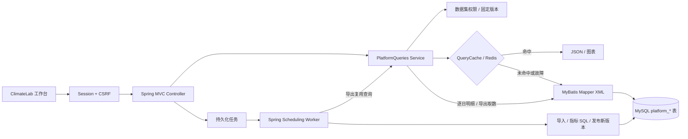

# ClimateLab · 气象数据管理与分析平台

一个单实例、可实际操作的内部科研平台：**登录 → 数据集与共享 → CSV 上传 → 事务导入 → 指标计算 → 版本化查询与图表 → 异步 CSV 导出**。

当前只保留 platform 一套业务。2026-10-23 已移除旧 `/api/**`、API Key 登录演示及重复增量任务；不需要再切换两个页面或配置两种认证。

本项目是基于保留的指标说明、SQL 和真实小样本进行的 **2026 年个人复建**，不等于当年的实习全部由本人独立完成。个人重点是 SQL、检索/聚合/导出接口与数据访问；登录、账号、共享和任务管理属于配套模块。详见 [职责与调用链](docs/unified-architecture.md)。

## 1. 启动与首次使用

需要 Docker Compose，已有的 `data/sample.csv` 即可运行；**不会扫描或导入原始 45 GB 数据**。

```bash
cd /Users/zuoxu/Desktop/recruitment/ucas-climate-service
python3 scripts/local_auth.py
docker compose --env-file .runtime/auth.env up -d --build

# 只在你自己的终端查看；不要截图或分享密码
python3 scripts/platform.py credentials
```

打开 [http://127.0.0.1:8087/](http://127.0.0.1:8087/)，账号 `admin`，密码来自上述命令。初始密码只在数据库没有该账号时使用，改环境变量不会重置已有密码。重建/重启 app 后需要重新登录。

首次启动依次执行：Flyway V1–V3 → 初始化样本（仅种子表为空时）→ 创建管理员与一次性只读示例 → 启动平台 Worker。之后重启会保留原数据、结果与文件，不自动覆盖示例。

推荐操作：

1. 打开“真实气象样本 · 只读示例”，认识三个站点、非连续年份和已有结果。
2. 点击“复制为我的数据集”，得到可独立导入、计算和授权的数据集。
3. 在“结果分析”切换站点阈值、逐日指标、站点年度频次、地区逐日/年度统计。
4. 提交导出，在任务中心观察状态，再到导出记录下载 CSV。
5. 创建研究人员/查看人员账号，体验私人数据集、READ/WRITE 共享和权限撤销。

真实样本口径约 26,004 条观测、4,185 条逐日结果，以当前数据集页面为准，不代表全球全量数据。

## 2. 主架构与模块



详细图源：[architecture.mmd](docs/architecture.mmd)。完整请求、缓存、导出与职责说明：[统一架构](docs/unified-architecture.md)。

Java 根目录：`src/main/java/cn/zuoxu/climate/`。

| 模块 | 当前职责 |
| --- | --- |
| `platform/PlatformClimateController` | Spring MVC 站点、分析和导出入口 |
| `platform/PlatformQueries` | 权限先于缓存、参数校验、固定版本、查询编排 |
| `data/PlatformQuery`、`data/PlatformClimateMapper`、`mapper/PlatformClimateMapper.xml` | 五类动态 SQL、绑定值、分页和 count；导出共用 |
| `service/QueryCache` | 唯一 Redis cache-aside 实现，不再依赖旧全局 revision 或 JDBC |
| `platform/PlatformDatasets`、`PlatformAccess` | 数据集、文件暂存、共享和权限 |
| `platform/PlatformTasks`、`PlatformWorker`、`PlatformProcessor` | 持久化接收、单线程认领、事务导入/计算、私有导出 |
| `platform/PlatformInbox`、`io/FileSnapshot` | 可选稳定文件发现、有界快照、复用上传/IMPORT 路径 |
| `platform/PlatformSecurity`、`PlatformUsers`、`security/SecurityErrors` | 唯一 Session 安全链、CSRF、角色、账号状态、JSON 错误 |
| `bootstrap/SampleLoadRunner`、`SampleLoader`、`SampleImporter`、`SampleAnalysis` | **仅首次示例初始化**，不是另一套对外业务服务 |
| `data/Observation` | 标准化记录校验，初始化与平台导入共用 |

查询 Service 不拼接 SQL；XML 用 `<choose>` 选择固定查询，用 `<if>` 处理地区筛选，所有请求值使用 `#{...}`，不使用 `${}`。

## 3. 数据和指标流程

网页上传只接受 UTF-8 标准化 13 列：

```csv
STATION,DATE,NAME,TEMP,PRCP,HUMIDITY,MAX,MIN,FRSHTT,country,province,city,district
```

站点保留 11 位前导零；日期 ISO；温度 °F、降水 in、湿度 0–1；缺失值不是 0，天气标记为六位。原始 40 列文件不能直接上传。每个上传最多 8 MiB、200,000 行。

计算分四阶段：1973–1992 基准分位数 → 1993 年起七类幅度/六类天气标记 → 站点年度非零/有效天数 → 地区均值、极值和中位数。请求查询读取派生结果，不在每个 HTTP 请求中重新计算整份原始数据。

平台所有观测按 `dataset_id` 隔离，派生结果再按 `result_version` 隔离。计算先写新版本，事务成功时切换指针；失败保留旧成功结果。原始观测采用 upsert，没有完整历史输入快照，不声称是完备数据血缘平台。

只读示例仍使用 V1 种子表与固定 `sql/rebuild.sql` 初始化，再复制到平台表。这部分确实还在使用，所以保留并明确放入 `bootstrap/`；所有后续平台查询、导入、计算、导出均操作 `platform_*`。V1–V3 已执行迁移及已有数据不删除、不改校验和，废弃的旧增量历史表不再被业务访问。

## 4. 缓存、任务和权限

缓存 Key：`{namespace}:platform:{datasetId}:{resultVersion}:{kind}:{参数摘要}`，包括规范化筛选条件、limit/offset，默认 TTL 1,800 秒。逐日明细和导出不缓存；其他结果 cache-aside。Redis 故障查 MySQL，小数缓存读取保留 BigDecimal。每次请求先授权；缓存命中并不免除数据库权限/版本检查。

任务状态：`QUEUED → RUNNING → SUCCESS / FAILED / INTERRUPTED`。IMPORT 整批事务导入、ANALYZE 事务发布结果、EXPORT 固定提交时的版本。默认单 Worker，积压上限 100；失败人工重试生成新任务。没有引入 MQ 或分布式任务框架。

用户为 ADMIN、RESEARCHER、VIEWER；数据集所有者可授予 READ/WRITE。密码 BCrypt，Session 30 分钟，修改请求需要 CSRF。账号禁用、共享撤销、任务执行和文件下载都会检查资格。只有一个账号认证体系，不再接受 API Key。

导出通过同一 MyBatis Mapper 取数，上限 20,000 行/32 MiB；文件私有保存，下载资格默认 7 天，每次下载重新授权。旧结果、过期/孤儿文件没有自动清理策略，不要误认为到期即物理删除。

## 5. 可选增量收件箱

默认关闭。开启：

```bash
CLIMATE_PLATFORM_INBOX_ENABLED=true docker compose --env-file .runtime/auth.env up -d --no-deps app
```

在平台创建普通数据集，向 `/app/.runtime/platform/inbox/<datasetId>/` 投递标准化 CSV（Docker 私有持久卷）。先写 `.part`，关闭后同目录原子改名 `.csv`；默认稳定 30 秒才处理。轮询有每轮/文件数上限，不跟随符号链接，不递归扫描磁盘。

新文件复用与网页相同的暂存、SHA-256 去重和 IMPORT 任务，只自动导入，**不自动发布新指标**；需要再提交计算。旧 `data/incremental/` 不再扫描，里面现有文件没有删除。详见 [业务指南](docs/platform-guide.md)。

## 6. 验证与运行维护

```bash
# Java 17、本机 MySQL/Redis；集成测试仅清理 _test 数据库
JAVA_HOME=/opt/homebrew/opt/openjdk@17 CLIMATE_IT=true mvn -B -ntp clean verify
python3 scripts/test_sampler.py
python3 scripts/test_local_auth.py

# 真实 HTTP 全业务；会新建明确标注的验证用户和数据集，保留已有数据
python3 scripts/platform.py verify

# 平台公式的独立 Decimal 核对，默认只读，只核对匹配 sample 的数据集
python3 scripts/verify_live.py
# 可选：额外创建一次异步 CSV 验证导出
python3 scripts/verify_live.py --export

# 重启完成后，核对数据、任务与全部五类导出文件仍在
python3 scripts/platform.py persistence-check
docker compose --env-file .runtime/auth.env logs -f app
```

没有 `CLIMATE_IT=true` 的 Maven 测试会跳过真实数据库集成测试，不等于完整验证成功。最新实测见 [验证记录](docs/platform-verification.md)。

更新代码只需 `docker compose --env-file .runtime/auth.env up -d --build --no-deps app`；不要 `down -v`，它会删除数据卷。MySQL/Redis/HTTP 默认仅监听本机。也可使用 `bash scripts/native-dev.sh run`，但不要与 Docker 争用同一端口或数据库。

私有 `.runtime/auth.env` 不进 Git。新环境只生成管理员初始化密码；旧文件中的废弃 API Key 为回滚保留，但应用不再读取或要求它们。不要把环境文件、数据库密码和终端凭据输出贴进文档。

## 7. 进一步阅读与边界

- [完整操作、调度和事务边界](docs/platform-guide.md)
- [平台 REST API](docs/platform-api.md)
- [统一架构与实习职责](docs/unified-architecture.md)
- [本次代码清理范围](docs/code-cleanup.md)

旧说明已移到 `docs/archive/`，只作历史记录，不是另一个需要运行的系统。原始数据、历史 SQL 和归档文档不等于无用代码，未随本次业务清理删除。

当前是本机、单实例、单 Worker 学习/科研复建。没有做全量 45 GB 导入、容量/并发压测、跨实例恢复或公网安全验收；没有真实线上流量或性能提升数字可供声称。任务持久化不等于所有故障绝不丢失。
