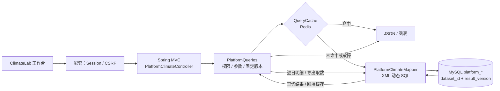
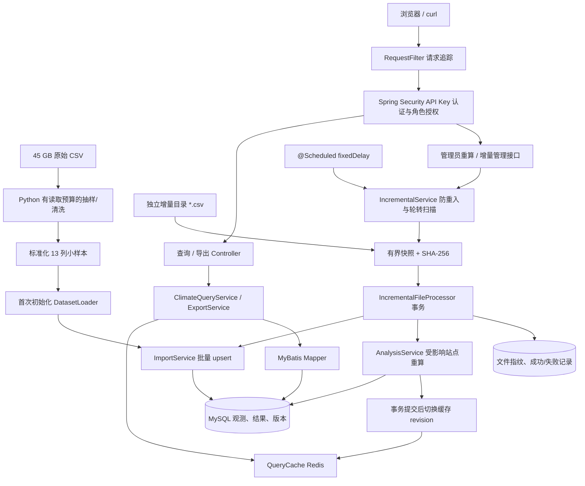
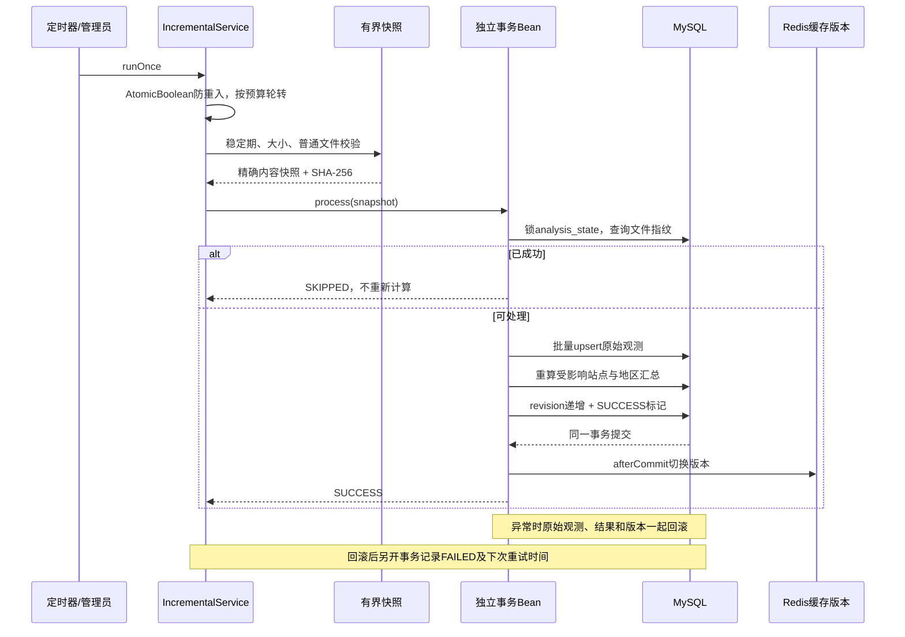

# ClimateLab · 气象数据管理与分析平台

> 历史归档（截至 2026-10-22）。旧 `/api/**`、API Key、旧增量服务和示例脚本已于 2026-10-23 移除；下文接口、路径、测试数量和操作命令仅反映当时状态，不适用于当前版本。当前使用方式以项目根 README 为准。

现在提供一个可实际操作的课题组业务平台：**账号登录 → 数据集创建/共享 → CSV 上传 → 后台导入 → 指标计算 → 版本化查询与图表 → 异步导出 → 鉴权下载**。

本次业务化扩展仍然是 2026 年个人复建，不代表当年的实习已经完成这些功能。原计算公式、旧表和 API Key 接口保留，新平台使用独立的 `platform_*` 表与 Session 登录，不混用两种身份。

平台是现在的主入口，气象查询不再绕过 MyBatis：**工作台 → Spring MVC（PlatformClimateController）→ PlatformQueries Service → QueryCache / MyBatis Mapper XML → MySQL**。缓存命中直接返回；未命中才由 Mapper 查库，逐日明细和导出直接走 Mapper。登录、账号、共享与任务管理是配套模块，不等于你在实习中全部负责。见 [统一架构与职责边界](docs/unified-architecture.md)。

## 先使用业务平台

```bash
cd /Users/zuoxu/Desktop/recruitment/ucas-climate-service
python3 scripts/local_auth.py
docker compose --env-file .runtime/auth.env up -d --build

# 在自己的终端查看本机初始管理员账号；不要截图或分享密码
python3 scripts/platform.py credentials
```

打开 [http://127.0.0.1:8087/](http://127.0.0.1:8087/)，使用 `admin` 和上面命令显示的密码登录。首次初始化后，更改环境变量不会重置数据库中的管理员密码。

建议第一次这样体验：进入“真实气象样本 · 只读示例” → 点击“复制为我的数据集” → “结果分析”切换阈值/逐日/年度/地区统计 → 点击“导出” → 在“导出记录”下载 CSV。随后在“账号管理”创建研究人员账号，体验私人数据集与共享授权。

完整说明见 [业务平台使用与架构](docs/platform-guide.md)、[平台 API](docs/platform-api.md)、[本次验证记录](docs/platform-verification.md)。

### 统一的平台查询架构



这里的 Service 包含五类气象检索，地区统计读取已计算的聚合结果；不是每次 HTTP 请求重新扫描原始数据计算中位数。异步导出由 Worker 调用同一个 Service/Mapper 取数。完整导入、计算、调度路径及简历讲解见 [架构详解](docs/unified-architecture.md)。下文原服务说明仅作为历史兼容接口与公式验证说明，不是平台查询的另一条主路径。

```bash
# 完整真实 HTTP 验证：会创建明确标注的验证账号/数据集，保留已有数据
python3 scripts/platform.py verify

# 重启 app，等待启动完成后验证数据、任务和导出文件仍在
docker compose --env-file .runtime/auth.env restart app
python3 scripts/platform.py persistence-check
```

业务平台只处理已有小样本和最多 8 MiB 的标准化 CSV，不会扫描原始 45 GB 文件。支持可选的 `Spring Scheduling` 数据集收件箱；默认关闭，见业务平台文档。

## 保留的原查询服务说明

一个可以实际运行、核对计算结果、演示后端完整流程的实习复建项目。业务来自保留的指标说明、SQL 草稿和真实气象数据：第一次实习做 SQL 查询与指标计算，第二次把已有查询接入后台。

本次补全了 **Spring Security API Key 鉴权、只读/管理员角色、Spring Scheduling 增量导入、持久化文件去重与失败记录**。这些代码属于 2026 年的复建增强，不代表当年的实习已经实现过全部功能。

- 项目目录：`/Users/zuoxu/Desktop/recruitment/ucas-climate-service`
- 原 API Key 演示页面：[http://127.0.0.1:8087/index.html](http://127.0.0.1:8087/index.html)
- 运行方式：Java 17 + Maven + MySQL 8 + Redis；也提供 Docker Compose。
- **下文 `/api/**` 是保留的 API Key 查询服务；新平台 `/platform/api/**` 使用独立的账号登录。** 两类页面可以匿名打开，业务数据均需要对应认证。
- 原始 45 GB 文件不会被定时任务扫描；日常运行使用已经生成的小样本和独立增量目录。

## 阅读路线

1. [功能和边界](#1-功能和边界)
2. [快速启动与密钥](#2-快速启动与密钥)
3. [架构、模块与数据库](#3-架构模块与数据库)
4. [从零搭建的实现顺序](#4-从零搭建的实现顺序)
5. [真实数据与四阶段计算](#5-真实数据与四阶段计算)
6. [接口鉴权怎么做](#6-接口鉴权怎么做)
7. [Spring Scheduling 增量服务](#7-spring-scheduling-增量服务)
8. [接口与使用示例](#8-接口与使用示例)
9. [配置、部署和运行维护](#9-配置部署和运行维护)
10. [验证、故障排查和面试讲解](#10-验证故障排查和面试讲解)

## 1. 功能和边界

| 能力 | 已实现的内容 |
| --- | --- |
| 数据清洗 | 对真实大文件做受限抽样，统一列序、站点编码、天气标记和缺失值 |
| 基准阈值 | 1973–1992，各站点温度/降水/湿度分别排除 NULL 后求经验分位数 |
| 逐日指标 | 1993 年起的 7 项幅度、6 类天气标记 |
| 汇总分析 | 地区逐日均值/极值/中位数，站点年度非零天数及地区统计 |
| 查询和导出 | Spring MVC → Service → MyBatis → MySQL；筛选、分页、有上限的 CSV |
| 缓存 | Redis cache-aside、TTL、计算版本隔离、故障回源 |
| 接口安全 | 全部业务 API 认证、READER/ADMIN 角色、401/403、无状态请求 |
| 增量处理 | 独立目录轮询、有界快照、SHA-256 去重、upsert、受影响站点重算 |
| 调度与恢复 | @Scheduled fixedDelay、单实例防重入、事务回滚、自动退避、管理员重试 |
| 可观测与交付 | 请求 ID、文件处理记录、任务状态、Flyway V1/V2、JUnit/JaCoCo、验证脚本 |

这是**单实例、内部科研查询工具**，没有加入用户注册、JWT、个人级数据权限、微服务、消息队列或分布式调度框架。没有做 45 GB 全量导入或容量压测，不声称生产级高并发或“绝对不丢数据”。

增量的准确含义：**增量发现/导入文件，按受影响站点重算站点结果，再重建地区汇总**。它不是全系统所有表都只更新新增行；第 7 节解释原因和取舍。

## 2. 快速启动与密钥

### 2.1 当前 Mac：一条命令运行

已有 `data/sample.csv` 时，不需要重新抽样：

```bash
cd /Users/zuoxu/Desktop/recruitment/ucas-climate-service

# 默认不自动轮询，可先手动测试：
bash scripts/native-dev.sh start

# 如果要开启定时增量任务：
CLIMATE_INCREMENTAL_ENABLED=true bash scripts/native-dev.sh restart
```

脚本会：

1. 生成或复用本机私有随机密钥，不在终端打印密钥内容。
2. 启动项目专用 MySQL `127.0.0.1:13306`、Redis `127.0.0.1:16379`。
3. 构建 JAR，启动 `127.0.0.1:8087`。
4. Flyway 自动执行数据库迁移；V2 增加增量任务记录和站点计算范围表。
5. **只在原始观测表为空时**导入样本并计算；重启不会覆盖现有增量数据，也不会每次全量重算。

在会清理后台子进程的工具终端中，使用前台模式并保持终端：

```bash
CLIMATE_INCREMENTAL_ENABLED=true bash scripts/native-dev.sh run
```

如果已有应用进程，先按实际运行方式停止应用，再选择前台运行。不要同时启动两个使用同一端口的实例。

### 2.2 页面怎么访问

打开 [原查询页面](http://127.0.0.1:8087/index.html)：

1. 用编辑器打开项目的 [本机密钥文件](.runtime/auth.env)。
2. 复制 `CLIMATE_READ_KEY=` **右边的值**，填入页面“接口密钥”。
3. 点击“连接 / 更换密钥”。
4. 选择四川达县站点，点击“基准阈值”“逐日指标”或导出 CSV。
5. 要查看/触发增量任务，改用 `CLIMATE_ADMIN_KEY` 对应的值重新连接。

密钥只保存在页面内存中，不写入 URL、Cookie、localStorage 或 sessionStorage；刷新后需要重新输入。导出也使用携带认证头的 fetch，不把密钥拼接到下载链接中。

如果数据库只有原始样本，元数据应为 `rawRows=26004`、`analysisRows=4185`。导入新的增量后，这些数字可能合理地变化。

### 2.3 命令行如何获取认证环境

本地启动脚本给 Java 子进程设置密钥，**不会反向修改当前终端环境**。运行 curl 前要显式加载：

```bash
cd /Users/zuoxu/Desktop/recruitment/ucas-climate-service
python3 scripts/local_auth.py
set -a
source .runtime/auth.env
set +a

curl -sS -H "X-API-Key: $CLIMATE_READ_KEY" http://127.0.0.1:8087/api/meta
```

`.runtime/auth.env` 保存两枚各 32 随机字节、64 位十六进制字符的密钥，文件权限设为 600，并已被 Git/容器构建忽略。不要截图、提交或分享这个文件，不要开启会回显命令参数的 `set -x`。

如果你主动设置了 `CLIMATE_READ_KEY / CLIMATE_ADMIN_KEY` 环境变量，启动脚本会优先使用它们；验证脚本同样优先读取环境变量。

### 2.4 日常命令

```bash
# 只启动数据库和 Redis
bash scripts/native-dev.sh services

# 查看启动日志
tail -f .runtime/logs/startup.log

# 应用日志
tail -f .runtime/logs/climate.log

# 停止本项目服务，保留数据库文件
bash scripts/native-dev.sh stop
```

本机 MySQL 默认在 `/usr/local/mysql`，可用 `CLIMATE_MYSQL_BASE` 覆盖。若本机没有项目 Redis，可运行 `bash scripts/bootstrap-redis.sh` 下载官方源码到项目运行目录并编译；也可走 Docker 方案。

## 3. 架构、模块与数据库

### 3.1 总体架构



### 3.2 核心模块

| 模块 | 主要文件 | 职责 |
| --- | --- | --- |
| 启动配置 | `ClimateApplication.java`、`application.yml` | Boot 启动、数据源、缓存、安全、调度参数 |
| 输入清洗 | `data/Observation.java` | 站点补零、天气标记、NULL、单位与字段校验 |
| 导入 | `data/ImportService.java`、`DatasetLoader.java` | 500 行批量 upsert，完整导入事务 |
| 计算 | `service/AnalysisService.java`、`sql/rebuild.sql` | 四阶段计算、站点范围、版本发布 |
| 查询 | `ClimateController.java`、`ClimateQueryService.java` | 参数验证、地区口径、分页 |
| SQL 映射 | `data/ClimateMapper.java`、`mapper/ClimateMapper.xml` | MyBatis 参数绑定与结果映射 |
| 缓存/导出 | `QueryCache.java`、`ExportService.java` | 回源、版本隔离、有界 CSV |
| 追踪与错误 | `RequestFilter.java`、`ApiErrors.java` | 请求 ID、耗时、结构化错误；不记录认证头 |
| 接口安全 | `security/ApiKeyFilter.java`、`SecurityConfig.java` | API Key 认证，READER/ADMIN 授权 |
| 增量编排 | `incremental/IncrementalService.java` | 有界目录扫描、稳定期、单进程防重入 |
| 文件与事务 | `FileSnapshot.java`、`IncrementalFileProcessor.java` | 精确指纹、原子导入/重算/成功标记 |
| 增量审计 | `IncrementalJobStore.java`、`IncrementalController.java` | 持久化记录、状态查询、管理员触发 |
| 调度 | `IncrementalScheduler.java`、`IncrementalProperties.java` | @Scheduled、配置绑定与范围校验 |
| 运维脚本 | `scripts/` | 原生启动、私有密钥生成、独立公式验证和演示 |
| 测试 | `src/test/` | 单元测试与真实 MySQL/Redis 集成测试 |

Java 代码根目录为 `src/main/java/cn/zuoxu/climate/`。SQL 资源在 `src/main/resources/`。没有单独建 DAO 目录，MyBatis Mapper 就是当前的数据访问层。

### 3.3 数据表和视图

| 对象 | 用途与关键键 |
| --- | --- |
| raw_observation | 原始观测；主键 `(station_code, observation_date)` |
| station_threshold | 站点五阈值及各变量有效基准样本数 |
| daily_indicator | 逐日 13 指标；站点/日期主键，地区和日期索引 |
| station_year_stat | 站点/年份/指标的非零天数和有效天数 |
| region_daily_stat | 日期/地区层级/地区字段/指标的均值、极值和中位数 |
| region_year_stat | 地区内站点年度非零天数的统计 |
| analysis_state | 单行计算版本、更新时间和观测/结果计数；写操作共同加锁 |
| incremental_file_job | 内容 SHA-256 唯一；文件名、状态、尝试次数、处理行数、版本、错误类型、下次重试时间 |
| analysis_scope | 同一事务内插入并清理的站点计算范围；不是持久化任务队列 |
| indicator_value / region_levels | 13 指标展开视图 / 四级地区视图 |

V1 建立业务表与视图，V2 增加增量处理所需对象。已发布迁移不回头修改，后续结构变更新增 V3 等迁移。

## 4. 从零搭建的实现顺序

下面是**按当前代码重新实现的依赖顺序**，不是对当年开发过程的虚构。

### 第一步：固定需求、字段和数据口径

先把“基准窗口、分析窗口、分位数、NULL、天气标记、年度频次”写清楚。原 CSV 的现成 LTD 等结果列不直接采用，全部从原始观测重算；原数据太大，先做有预算的样本。

### 第二步：先把 SQL 和数据库跑通

建立原始观测、阈值、逐日指标、年度统计和地区统计表；用联合主键防止站点同日重复。先用固定小样本手算，再写 `rebuild.sql`，不要让接口或 Redis 掩盖公式问题。

### 第三步：导入器和计算事务

`Observation.from` 负责单行清洗，`ImportService` 流式解析 CSV，每 500 行批量写入。`DatasetLoader.load` 的外层事务把初次导入与计算包在一起。任何一行格式错误或计算失败，整次导入回滚，不留下半批数据。

### 第四步：把原 SQL 接成查询接口

Controller 接受站点/日期/地区/指标 → Service 验证并组织参数 → MyBatis 使用 `#{...}` 绑定查询值 → 返回 JSON。逐日记录使用 `[from,to)` 日期区间并有分页；指标和地区层级使用枚举，不接受用户传 SQL。

### 第五步：补缓存和 CSV

阈值、地区统计走 cache-aside；大明细和导出不缓存。导出按 500 行取数、控制总量，在同一个只读事务里保持一致快照。Redis 异常回源 MySQL，不让缓存故障变成数据不可读。

### 第六步：给整个入口加认证和授权

把原来“只保护 /api/admin”的逻辑升级为 Spring Security：

1. RequestFilter 先生成请求 ID。
2. ApiKeyFilter 校验 X-API-Key，建立带角色的 Authentication。
3. SecurityFilterChain 匹配路径与方法，管理员操作要求 ADMIN，读取要求 READER。
4. 没有认证返回 401；身份有效但角色不足返回 403。
5. Controller 执行业务，结束后安全上下文由安全过滤链清理。

### 第七步：把计算改为可指定站点范围

导入时收集受影响站点；在事务中把站点以绑定参数写入 `analysis_scope`。同一份 SQL 根据受控范围条件计算：

- 全量重算时条件是 TRUE。
- 增量时只删除/重建受影响站点的阈值、历史逐日指标、年度结果。
- 地区统计依赖多个站点，再从完整站点结果重建。

SQL 模板只代入代码常量和服务端生成的 UUID，**站点号、地区名等输入不作为 SQL 片段拼接**。

### 第八步：添加文件指纹、重试与定时器

先实现手动 `runOnce`，确认去重和失败回滚；再让 @Scheduled 调用同一个方法。调度层不直接写导入 SQL，事务方法放在独立 Spring Bean 上，避免自调用绕过 `@Transactional`。

### 第九步：验证完整链路

分别验证公式、查询、安全、文件处理、真实定时触发，再重新运行原有真实样本 oracle。不能把“编译成功”“注解存在”当作定时功能或业务正确性的证明。

## 5. 真实数据与四阶段计算

### 5.1 真实样本怎么来的

原始 `/Users/zuoxu/Desktop/new_data_deal/raw.csv` 为 **45,314,368,644 字节**。已有样本后，本次鉴权/调度增强没有重新扫描它。

抽样器先做 512 次小范围定位识别年份区段，再读取需要年份开头最多 2 MiB；默认读取预算 96 MiB。初版单次实际读取 **50,984,841 字节，约 0.1125%**。修正列布局时重抽过一次，初版累计约 102 MB。详见 `data/sample-manifest.json`。

已有样本：

- 26,004 条原始观测，约 2.8 MB。
- 1973–1992 的全部 20 个基准年份。
- 分析年份仅 1993、1994、2022、2023，不能假设中间年份都有观测。
- 三站：法国 CARPIQUET `07027099999`、土库曼斯坦 ASHGABAT `38880099999`、四川达县 DA XIAN `57328099999`。
- 选择的是受限年份窗口中共同存在的完整站点，**不是随机、有气候代表性的样本**。

重新抽样不是日常启动步骤，确实需要时才执行：

```bash
python3 scripts/sample_source.py --source /Users/zuoxu/Desktop/new_data_deal/raw.csv
```

不要对原文件执行全量 pandas.read_csv，也不要把它复制到增量目录。

### 5.2 标准化 CSV 的准确格式

必须是下列 **13 列、同样的大小写和顺序**：

```csv
STATION,DATE,NAME,TEMP,PRCP,HUMIDITY,MAX,MIN,FRSHTT,country,province,city,district
```

| 字段 | 口径 |
| --- | --- |
| STATION | 1～11 位数字，Java 补为 11 位；数据库按字符保存以保留前导零 |
| DATE | ISO 日期，例如 2024-01-01；不包含时区 |
| NAME | 站点名，最多 160 字符 |
| TEMP / MAX / MIN | 华氏度；9999.9、空值、NaN 处理为 NULL |
| PRCP | 英寸；99.99、空值、NaN 处理为 NULL；不允许负降水 |
| HUMIDITY | 0～1 比例；不填入 50 代表 50% |
| FRSHTT | 最多 6 位 0/1；左补零，空值保持 NULL |
| country/province/city/district | 地理名称，最多各 96 字符，缺失用空字符串 |

输入是 UTF-8 标准化观测，不是原始 40 列大 CSV，也不是接口导出的派生结果 CSV。天气标记 `10000` 补成 `010000`，代表雨，不能补到右边。

原文件不同年份的湿度列位置变化，Python 抽样阶段处理这种布局差异，Java 导入器只接受统一格式。字段来源可参阅 [NOAA GSOD 字段说明](https://www.ncei.noaa.gov/data/global-summary-of-the-day/doc/readme.txt)。

### 5.3 第一阶段：五个站点基准阈值

基准窗口为 `1973-01-01 <= date < 1993-01-01`。各变量分别排除 NULL，排序后取第 `ceil(p × n)` 项：

- 温度：10%、90%。
- 降水：95%、99%。
- 湿度：5%。

默认三个变量都至少有 30 条有效样本才发布该站阈值；测试小样本用 2。此处明确采用经验 nearest-rank，和旧草稿 PERCENT_RANK 的边界写法并非完全等价，正式科研口径应由需求方确认。

### 5.4 第二阶段：逐日指标

分析观测按站点关联阈值，计算：

| 指标 | 公式 |
| --- | --- |
| LTD | max(0, TEMP10 − TEMP) |
| HTD | max(0, TEMP − TEMP90) |
| HR | max(0, PRCP − PRCP95) |
| EHR | max(0, PRCP − PRCP99) |
| LH | max(0, HUMIDITY5 − HUMIDITY) |
| HTD1 | max(0, MAX − 95) |
| CTD1 | max(0, 5 − MIN) |

另拆分 `FOG / RAIN / SNOW / HAIL / THUNDER / TORNADO` 六个天气标记。幅度缺失保持 NULL，不冒充 0；无基准阈值的观测不发布日指标，并在 analysis_state 中计数。

### 5.5 第三、四阶段：地区和年度

地区日统计按 **日期 + 层级 + 地区字段 + 指标** 分组；日期不能省略。均值/极值用聚合，中位数用窗口行号，奇数取中间项，偶数取中间两项平均。

年度频次是“该站该年该指标 >0 的观测天数”，同时返回有效天数，**不是发生概率，也不把不完整观测外推成全年**。再对各站年度非零天数做地区统计。区县层级只为中国生成；同站同年地理归属冲突时拒绝计算，不能默默混算。

## 6. 接口鉴权怎么做

### 6.1 为什么选择 API Key，而不是登录/JWT

这是内部数据查询服务，用两个机器级角色就能演示访问控制。API Key 不需要为了短期项目再虚构一套用户中心。

- **认证 Authentication**：请求携带的密钥是否有效，它对应哪个服务身份。
- **授权 Authorization**：这个身份能不能访问当前接口。
- 这里是 READER/ADMIN **共享服务角色**，不是个人账号，也没有每人、每站点的数据权限隔离。

### 6.2 权限矩阵

| 资源 | 无密钥 | READER | ADMIN |
| --- | --- | --- | --- |
| 页面 /、/index.html | 可访问 | 可访问 | 可访问 |
| GET /actuator/health | 可访问 | 可访问 | 可访问 |
| 业务查询 GET /api/** | 401 | 可访问 | 可访问 |
| 业务 CSV 导出 | 401 | 可访问 | 可访问 |
| /api/admin/** | 401 | 403 | 可访问 |
| 未开放的方法/路径 | 默认拒绝 | 默认拒绝 | 默认拒绝 |

管理员接口仍须匹配真实路由；ADMIN 不是任意方法、任意 URL 都能成功。

### 6.3 关键实现

- 使用 Spring Security 6.5.11，由 Boot 的依赖管理确定版本，不手写一套替代安全框架。
- 密钥只接受一个 `X-API-Key` 头；不接受 URL 中的 apiKey，也不继续接受旧的 X-Admin-Key。
- 两枚密钥必须不同，且至少 32 个字符；未配置则 Web 服务启动失败，不回退到公开默认口令。
- 先将凭据计算为固定长度 SHA-256，再用 MessageDigest.isEqual 比较；不会将原始密钥保存到 Authentication 的 credentials。
- 角色由服务器的密钥映射决定，不相信客户端的 X-Role 等字段。
- STATELESS，不创建登录 Session，不启用表单登录、HTTP Basic 或默认生成密码。
- CSRF 关闭仅针对本方案的前提：身份凭据由客户端显式加在头中，浏览器不会自动附带认证 Cookie。将来改 Cookie 登录时需要重新设计。
- Filter 在 SecurityFilterChain 内注册一次，不能同时作为普通 Servlet @Component Filter 重复注册。
- 不记录密钥；失败响应仅返回错误代码、说明、requestId。

参考与本项目版本匹配的 [Spring Security 过滤链文档](https://docs.spring.io/spring-security/reference/6.5/servlet/architecture.html) 和 [HTTP 授权文档](https://docs.spring.io/spring-security/reference/6.5/servlet/authorization/authorize-http-requests.html)。

### 6.4 安全边界与密钥轮换

默认仅监听 127.0.0.1。若跨机器部署，需要 HTTPS、网络边界、真正的密钥管理、限流和审计，不应直接裸露本例 HTTP 端口。

密钥没有自动过期，也没有多把并行轮换窗口。更换进程使用的密钥并重启后旧值失效。若使用生成文件，可先将旧文件移到私有备份位置，再生成新的 auth.env；同时检查终端是否仍导出了旧密钥。不要把备份提交 Git。

## 7. Spring Scheduling 增量服务

### 7.1 输入不是“继续读取 45 GB”

任务只观察配置的独立目录，默认 `data/incremental`，只看顶层以小写 .csv 结尾的文件。它不跟踪原始大文件追加偏移，不递归遍历 Desktop，也不读取原始压缩包。

推荐投递协议：

1. 上游先写 `batch-001.part`。
2. 写入完成、关闭文件。
3. 在同一目录原子改名为 `batch-001.csv`。
4. 文件满足默认 30 秒稳定期后，才允许处理。

稳定期是降低读半成品概率的措施，不代替原子发布协议。处理前做有界临时快照，复制同时计算 SHA-256，并核对复制前后的大小、修改时间和文件标识，发现变化就拒绝本轮。

### 7.2 一次任务的完整流程



### 7.3 真正增量到哪一层

- **文件层**：以完整内容 SHA-256 去重。相同内容改名仍跳过；同名修改内容会成为一个新批次。
- **观测层**：`(station_code,date)` upsert，允许晚到数据和历史订正，不只是追加最新日期。
- **站点层**：重算此次涉及站点的阈值、所有历史日指标、年度结果，其他站点结果不删除。
- **地区层**：从全部站点结果重新聚合地区日/年统计；不是只对旧均值/中位数简单加一条。
- **版本层**：一次文件处理成功只推进一次 revision；重复文件不推进。

这里的“相同内容”指字节相同；仅换行符、记录排序或空白变化也会改变文件指纹。逻辑记录是否重复由站点/日期主键与 upsert 兜底，不把文件摘要当成逐条业务记录 ID。

基准期一条旧观测变化，可能改变分位阈值，继而改变该站所有分析年的结果，所以不能只重算新文件中的日期。地区中位数也不能根据旧中位数和新值简单更新。本版用更容易验证的重聚合保证口径正确，适合当前样本规模。

扫描已处理文件仍需读取小文件以核对指纹，**没有声称零重复 I/O**。预算限制每轮工作量，后续可手动归档成功文件减少读取；重启后仍靠数据库指纹去重。

### 7.4 事务和“只处理一次”的边界

`IncrementalFileProcessor.process` 是单独 Bean 的 @Transactional 方法，从编排器经 Spring 代理调用：

- 锁 analysis_state 的同一行，和初次导入、管理员重算使用共同写锁。
- 文件导入、结果重算、revision、成功标记在**同一个 MySQL 事务**中提交。
- 如果 CSV 第 501 行之后出错，前面已 flush 的批次也回滚。
- 如果 SQL 计算失败，新观测与已改结果同时回滚，读者不会看到半套已提交结果。
- 成功标记只有提交后可见。崩溃在提交前，则没有成功标记，可重新处理；提交后重扫则跳过。
- 失败记录在原事务结束后，用 REQUIRES_NEW 独立写入，防止随着业务回滚一起消失。
- 同进程的定时/手动请求用 AtomicBoolean 防重入；数据库锁内再次检查指纹，避免简单的“先查后插”竞态。

RUNNING 是业务事务中的中间值，**并非已独立提交的长期运行租约**。正常对外可见的持久化终态为 SUCCESS/FAILED；运行状态和 lastRun 在进程内，重启会重置，文件终态与尝试次数不会重置。

这不是分布式 exactly-once 承诺。缓存版本目前在服务进程内维护，仍按单实例设计；不要额外开另一个导入进程去绕过运行中实例修改数据库。多实例、外部副作用和更大规模调度需要另行设计。

### 7.5 默认预算和失败重试

| 项目 | 默认值 |
| --- | --- |
| 自动运行 | false，需显式开启 |
| fixedDelay | 上一轮结束后再等 60 秒 |
| 首次延迟 | 30 秒 |
| 文件最小年龄 | 30 秒 |
| 单文件大小 | 8 MiB，可配置，但上限不能超过 64 MiB |
| 单文件行数 | 200,000，由导入器限制 |
| 每轮文件数 | 5，包含跳过/延后/拒绝的候选 |
| 收件目录上限 | 500 个 CSV，超限明确报错，不悄悄忽略后面的文件 |
| 自动最大尝试 | 同一指纹最多 3 次 |
| 重试间隔 | 60 秒固定退避 |
| 文件事务超时 | 120 秒，基于 Spring/JDBC，不保证强制终止全部文件 I/O |

目录稳定时用轮转游标分配每轮预算，避免总停留在前几个成功文件上。原始投递文件不删除、不自动移动；临时快照在处理完后清理。

任务返回值要看明细，不能只看 HTTP 200：

| 状态 | 含义 |
| --- | --- |
| SUCCESS | 文件事务成功并提交 |
| SKIPPED | 内容指纹已成功，不重复导入 |
| DEFERRED | 文件太新，或失败重试仍在退避/达到自动次数上限 |
| FAILED | 导入或计算事务失败，已尝试持久化失败记录 |
| REJECTED | 快照/文件校验等前置步骤拒绝，可能还没有指纹，因此不保证有持久化文件记录 |
| busy=true | 本进程已有任务执行，本次不再启动 |
| error 非空 | 目录扫描级错误，例如目录过满 |

数据库本身不可用时，失败审计也可能写不进去；原文件仍在，下次恢复后再试。查询文件记录里的 error_code 和应用日志，不要把“失败记录总能落盘”说成保证。

管理员 `retryFailed=true` 可绕过退避和自动次数上限，但只针对**本轮扫描到且仍在目录里的文件**；不是把历史所有失败自动无限重试。

### 7.6 开启、查看和手动执行

```bash
CLIMATE_INCREMENTAL_ENABLED=true bash scripts/native-dev.sh restart

# 在当前终端加载认证环境
set -a
source .runtime/auth.env
set +a

curl -sS -H "X-API-Key: $CLIMATE_ADMIN_KEY" \
  http://127.0.0.1:8087/api/admin/incremental/status

curl -sS -X POST -H "X-API-Key: $CLIMATE_ADMIN_KEY" \
  http://127.0.0.1:8087/api/admin/incremental/run

curl -sS -H "X-API-Key: $CLIMATE_ADMIN_KEY" \
  'http://127.0.0.1:8087/api/admin/incremental/jobs?limit=20&offset=0'

curl -sS -X POST -H "X-API-Key: $CLIMATE_ADMIN_KEY" \
  'http://127.0.0.1:8087/api/admin/incremental/run?retryFailed=true'
```

自动调度关闭时，手动扫描仍可用。改配置后要重启；设置环境变量并不会修改已经运行的 Java 进程。

### 7.7 投递一份可核对的演示增量

优先使用真实集成测试，它只修改独立 _test 库。若想在页面看见新数据，可主动执行：

```bash
python3 scripts/publish_incremental_demo.py
```

脚本以 .part → .csv 的方式投递 **31 条明确标记的合成观测**：

- 专用站点 `99999000001`，名称 SYNTHETIC INCREMENTAL DEMO，国家“演示国”。
- 1973 年 30 条基准记录 + 2024-01-01 一条分析记录。
- **这会给当前数据库新增合成数据，不是找回的真实科研观测，也不会覆盖原来的三个真实站点。**

等待稳定期和下一轮调度，或 30 秒后手动扫描，再查询任务记录和该站日指标。再次投递相同内容会被文件指纹跳过。

原始样本 oracle 默认严格核对原始样本总行数；加入这份合成数据后总数变化，它会提示不一致。不要为了让 oracle 通过随意删数据，应该用独立测试库演示，或为扩展数据另建对应的验证输入。

## 8. 接口与使用示例

### 8.1 接口一览

| 方法与路径 | 权限 | 用途 |
| --- | --- | --- |
| GET / | 公开页面 | 输入密钥后查询、导出、操作增量面板 |
| GET /actuator/health | 公开 | 应用/MySQL 健康，Redis 降级不阻断 |
| GET /api/meta | READER | 计算版本、计数、口径、单位 |
| GET /api/stations | READER | 站点和数据覆盖范围，最多 200 个 |
| GET /api/stations/{station}/thresholds | READER | 五阈值与有效基准样本数 |
| GET /api/stations/{station}/indicators | READER | 逐日指标，[from,to)，limit 1～500 |
| GET /api/stations/{station}/annual | READER | 指定年 13 指标的非零/有效天数 |
| GET /api/aggregates/daily | READER | date、level、metric 和可选地区筛选 |
| GET /api/aggregates/annual | READER | year、level、metric 和可选地区筛选 |
| GET /api/exports/daily.csv | READER | 有上限的逐日 CSV |
| GET /api/exports/thresholds.csv | READER | 基准阈值 CSV |
| GET /api/exports/station-annual.csv | READER | 站点年度 CSV |
| GET /api/exports/region-daily.csv | READER | 地区逐日 CSV |
| GET /api/exports/region-annual.csv | READER | 地区年度 CSV |
| POST /api/admin/rebuild | ADMIN | 现有观测的全量重算，不导入任意路径 |
| GET /api/admin/cache | ADMIN | 缓存统计和当前版本 |
| GET /api/admin/incremental/status | ADMIN | 开关、运行状态、预算和最近一轮结果 |
| GET /api/admin/incremental/jobs | ADMIN | 文件处理历史，limit 1～100，offset 0～10000 |
| POST /api/admin/incremental/run | ADMIN | 同步执行一轮；可选 retryFailed |

ADMIN 同时拥有 READER。完整参数说明见 [API 文档](docs/api.md)。

### 8.2 阈值、明细与分页

```bash
curl -i -H "X-API-Key: $CLIMATE_READ_KEY" \
  http://127.0.0.1:8087/api/stations/57328099999/thresholds

curl -sS -H "X-API-Key: $CLIMATE_READ_KEY" \
  'http://127.0.0.1:8087/api/stations/57328099999/indicators?from=1993-01-01&to=1994-01-01&limit=10&offset=0'

curl -sS -H "X-API-Key: $CLIMATE_READ_KEY" \
  'http://127.0.0.1:8087/api/stations/57328099999/annual?year=1993'
```

注意 `to` 不包含在结果中。分页响应是 `items / limit / offset / hasMore`，不为了翻页额外执行全量 COUNT。下一页 offset 增加 limit。

四川达县原样本五阈值可核对为：

```text
TEMP10 = 43.9°F
TEMP90 = 82.4°F
PRCP95 = 0.83 英寸
PRCP99 = 2.09 英寸
HUMIDITY5 = 0.5056259581
```

### 8.3 地区统计

```bash
curl -sS -G -H "X-API-Key: $CLIMATE_READ_KEY" \
  http://127.0.0.1:8087/api/aggregates/daily \
  --data-urlencode date=1993-01-01 --data-urlencode level=COUNTRY \
  --data-urlencode metric=HTD --data-urlencode country=中国

curl -sS -G -H "X-API-Key: $CLIMATE_READ_KEY" \
  http://127.0.0.1:8087/api/aggregates/annual \
  --data-urlencode year=1993 --data-urlencode level=PROVINCE \
  --data-urlencode metric=RAIN --data-urlencode country=中国 \
  --data-urlencode province=四川省
```

level 为 COUNTRY/PROVINCE/CITY/DISTRICT。日汇总只接受七项幅度指标，年统计另支持六项天气。地区参数用 URL 编码和 SQL 绑定，不拼接 SQL。

### 8.4 导出和缓存

```bash
curl -f -H "X-API-Key: $CLIMATE_READ_KEY" -o climate.csv \
  'http://127.0.0.1:8087/api/exports/daily.csv?station=57328099999&from=1993-01-01&to=1994-01-01'

python3 scripts/export_demo.py
```

逐日导出最多 20,000 行、每次查询 500 行，在同一 REPEATABLE READ 只读事务中完成。其他导出也有上限；UTF-8 BOM 便于 Excel 显示中文。

连续请求同一个阈值/地区汇总，可观察 X-Cache：MISS → HIT。Redis 故障为 UNAVAILABLE，关闭缓存为 BYPASS；TTL 1800 秒。key 包含计算版本、查询种类和规范化参数散列。

### 8.5 验证 401 与 403

```bash
# 无认证：401
curl -i http://127.0.0.1:8087/api/meta

# 合法只读身份，但不允许管理：403
curl -i -H "X-API-Key: $CLIMATE_READ_KEY" \
  http://127.0.0.1:8087/api/admin/incremental/status

# 管理员：200
curl -i -H "X-API-Key: $CLIMATE_ADMIN_KEY" \
  http://127.0.0.1:8087/api/admin/incremental/status
```

错误 JSON 含 error、message、requestId，响应头含 X-Request-Id。参数错误 400、缺少站点阈值 404、数据库故障 503；非预期异常 500。

## 9. 配置、部署和运行维护

### 9.1 重要配置

| 配置/环境变量 | 默认值或说明 |
| --- | --- |
| DB_URL / DB_USER / DB_PASSWORD | 本机项目库 climate_rebuild，端口 13306；开发账号仅用于本机 |
| REDIS_HOST / REDIS_PORT | 127.0.0.1 / 16379 |
| SERVER_ADDRESS / SERVER_PORT | 127.0.0.1 / 8087 |
| CLIMATE_READ_KEY / CLIMATE_ADMIN_KEY | 无公开默认值；Web 启动必须配置两枚不同的长密钥 |
| CACHE_ENABLED | true |
| MIN_BASELINE_SAMPLES | 30；测试为 2 |
| CLIMATE_INCREMENTAL_ENABLED | false |
| CLIMATE_INCREMENTAL_DIRECTORY | data/incremental，相对 Java 进程工作目录 |
| CLIMATE_INCREMENTAL_DELAY_MS | 60000，最少 100 |
| CLIMATE_INCREMENTAL_INITIAL_DELAY_MS | 30000，最少 0 |
| CLIMATE_INCREMENTAL_MIN_AGE_MS | 30000，最少 0 |
| app.incremental.max-file-bytes | 8388608，最大 67108864 |
| app.incremental.max-files-per-run | 5，允许 1～50 |
| app.incremental.max-inbox-files | 500，允许 1～5000 |
| app.incremental.max-attempts | 3，允许 1～20 |
| app.incremental.retry-delay-seconds | 60，至少 1 |

高级参数可写 application.yml 或用 Boot 启动参数覆盖，例如 `--app.incremental.max-files-per-run=2`。延迟单位是**毫秒**，不要把 60 当成 60 秒。配置不是运行时热更新，修改后重启。

fixedDelay 是“上次完成后再等待”，不是固定钟点 cron，也不是到点不管上次是否结束都开启新线程。调度线程池大小为 1；这里没有再加 @Async。参考 [Spring Framework 6.2 Scheduling 文档](https://docs.spring.io/spring-framework/reference/6.2/integration/scheduling.html)。

### 9.2 只运行 Java

先准备 MySQL 8、Redis，设置数据源和认证环境：

```bash
mvn -B -ntp package
set -a
source .runtime/auth.env
set +a

java -jar target/ucas-climate-service-1.0.0.jar \
  --app.import-file=data/sample.csv --app.import-if-empty
```

Spring Boot 不会自动 source shell 的 .env 文件。首次导入可用非 Web 命令：

```bash
java -jar target/ucas-climate-service-1.0.0.jar \
  --spring.main.web-application-type=none \
  --app.import-file=data/sample.csv --app.exit-after-import
```

此命令修改数据库，应在查询服务停服后使用，随后重新启动服务，避免另一个进程持有旧缓存版本。

### 9.3 Docker Compose

本机 Docker daemon 若不可用，继续使用原生方案。本次已校验配置语法，没有把它当作镜像构建/容器实测。

```bash
python3 scripts/local_auth.py

# 不输出包含密钥的完整解析配置：
docker compose --env-file .runtime/auth.env config --quiet

docker compose --env-file .runtime/auth.env up -d mysql redis
docker compose --env-file .runtime/auth.env run --build --rm app \
  --spring.main.web-application-type=none \
  --app.import-file=/app/data/sample.csv --app.exit-after-import

CLIMATE_INCREMENTAL_ENABLED=true \
  docker compose --env-file .runtime/auth.env up -d app
```

注意：

- 先停止占用同样端口的本机项目服务，再启动容器；数据库数据目录与命名卷是两个独立存储。
- 容器内数据库服务名是 mysql/redis，不是 127.0.0.1。
- 样本与增量目录通过 data 只读挂载；上游在宿主机投递，容器只读取，不删除原文件。
- MySQL 数据放命名卷；docker compose down 默认保留卷，不随意添加 -v。
- 更改环境后使用 up -d --force-recreate app，单纯 restart 不重新读取容器环境。
- 容器使用非 root 用户；开发密码不能直接用于生产。

### 9.4 索引与性能观察

```bash
/usr/local/mysql/bin/mysql --no-defaults \
  --socket="$PWD/.runtime/mysql.sock" -uroot climate_rebuild < scripts/explain.sql
```

站点等值 + 日期范围适配联合主键；地区索引适配地区筛选。初版对照发现正常查询使用 PRIMARY 范围扫描，显式忽略索引则扫描结果表并排序。它只是小样本执行计划，不是原实习提速百分比，也不是本次吞吐压测。

增量任务串行写入，地区重聚合仍可能耗时；大数据场景应改为分区/版本化离线构建、分批发布和更精细的地区范围计算，不能直接把当前样本性能外推到 45 GB。

## 10. 验证、故障排查和面试讲解

### 10.1 自动化与独立公式验证

```bash
# 单元测试；数据库集成测试默认跳过
mvn -B -ntp test

# 专用 _test 数据库 + 真实 Redis 的完整测试
bash scripts/native-dev.sh test

# 或数据库服务已运行时：
CLIMATE_IT=true mvn -B -ntp clean package

# 不读原始大文件，读取标准化样本做独立 Decimal 核对
python3 scripts/verify_live.py

# 真实 HTTP 鉴权/权限/增量管理接口验证，默认只读
python3 scripts/verify_access.py
# 只有显式加 --run-once，才会执行一轮收件目录扫描
python3 scripts/verify_access.py --run-once

# 抽样器小数据测试
python3 scripts/test_sampler.py
```

完整测试会清理并重建**名称以 _test 结尾的专用测试库里的测试数据**，不清理 climate_rebuild 样本库。不要把自己的业务数据存入这个测试库。

本次 Java 完整回归 **33 个测试全部通过，无跳过**，包括：

- 原有 SQL 口径、奇偶中位数、日期分组、缺失值、导出、缓存与参数化查询。
- 无密钥 401、错误密钥 401、只读访问管理 403、管理员访问正常。
- 重复认证头拒绝，客户端声明角色不能提权。
- 快照指纹、源文件保留、超大文件/符号链接拒绝。
- 同内容改名跳过、同名改内容创建新批次、历史基准订正后重算。
- CSV 已批量写入后再报错，整批回滚；计算失败也回滚原始数据和版本。
- 自动退避、最大尝试次数、管理员重试。
- 有界轮转、文件稳定期、目录过满、防重入。
- **真正由 Spring 定时器触发文件导入**，后续多轮不会重复推进版本。

抽样器另有 4 个测试通过；升级后的原样本 Decimal oracle **11,895 项断言通过**。Java 报告在 target/surefire-reports，覆盖率在 target/site/jacoco/index.html；独立样本验证报告在 [docs/live-verification.json](docs/live-verification.json)，详细记录见 [docs/verification.md](docs/verification.md)。

### 10.2 常见故障

**启动报 Two different API keys ...**

没有设置密钥、长度不足或两枚值相同。运行 local_auth.py 并使用 native-dev.sh，或正确导出两枚密钥。不要为了启动删除鉴权逻辑。

**页面打开，但查询报 401**

页面是公开壳，数据接口是受保护的。输入实际进程使用的密钥并点击连接；不能把等号左边变量名一起粘贴。若用了外部环境变量，auth.env 里的值可能不是当前进程值。

**任务状态报 403**

认证成功但你使用了 READER。改用 ADMIN，不是让前端多传一个 role=admin。

**定时任务没有执行**

查看 status.enabled；修改环境后是否重启？文件是否为顶层小写 .csv？是否还在 .part、过于新、超大或为链接？目录是否过满？调度是上一轮结束后再等待，不是固定钟点。

**文件是 DEFERRED**

可能未过 30 秒稳定期，或之前失败处于退避/达到自动次数上限。先查 jobs 的 attempts、next_retry_at、error_code，再决定修复文件或管理员重试。

**文件 FAILED**

原始数据和结果已经回滚，按 error_code 查同时间日志。常见原因是表头不是标准化 13 列、字段非法、同站同年地理归属冲突、数据库不可用。不要通过跳过失败行静默得到不完整科研结果。

**同名新文件没有增加原始行数**

导入处理行数不等于新增行数。相同站点日期走 upsert；相同完整内容甚至直接跳过。检查数据是否是订正，以及 revision 和任务 SHA-256。

**数据库有新结果，旧服务却仍有旧缓存**

当前缓存 revision 在进程内更新，要求单实例写入。不要在运行中另开 CLI 导入；通过本服务的管理/增量接口处理，或停服导入后重启。

**启动环境换了，数据怎么没了**

本机 MySQL 数据目录与 Docker 卷独立；切换连接不是复制数据。确认 DB_URL 和实际数据库。停服、重启不会自动删除数据库。

### 10.3 可以如实讲的项目内容

“第一次实习主要按科研需求写查询和统计 SQL，第二次参与把查询做成后端。现在准备面试时，我根据保留材料做了可运行复建，并新增接口鉴权和定时增量：上游投递标准化小 CSV，后端按文件指纹去重，事务内导入并重算受影响站点，成功后切换缓存版本，失败可核对记录并重试。”

能够讲清：数据从哪里来、字段如何清洗、公式口径、一次接口路径、权限在哪里判断、一次增量事务怎样提交、为什么旧基准修订影响历史、为何地区中位数仍重算、测试证明了哪些边界。

不能声称：原实习已经用了这里所有类/版本/权限机制，或做过没有证据的线上事故处理、JWT/RBAC 用户中心、分布式 exactly-once、高并发压测、45 GB 全量计算和未测量的性能提升。

更详细的项目口述与公式背景见 [项目流程与面试讲解](docs/project-walkthrough.md)。本项目的价值是让你现在真正跑通并理解这些实现，不是补造过去的开发历史。
