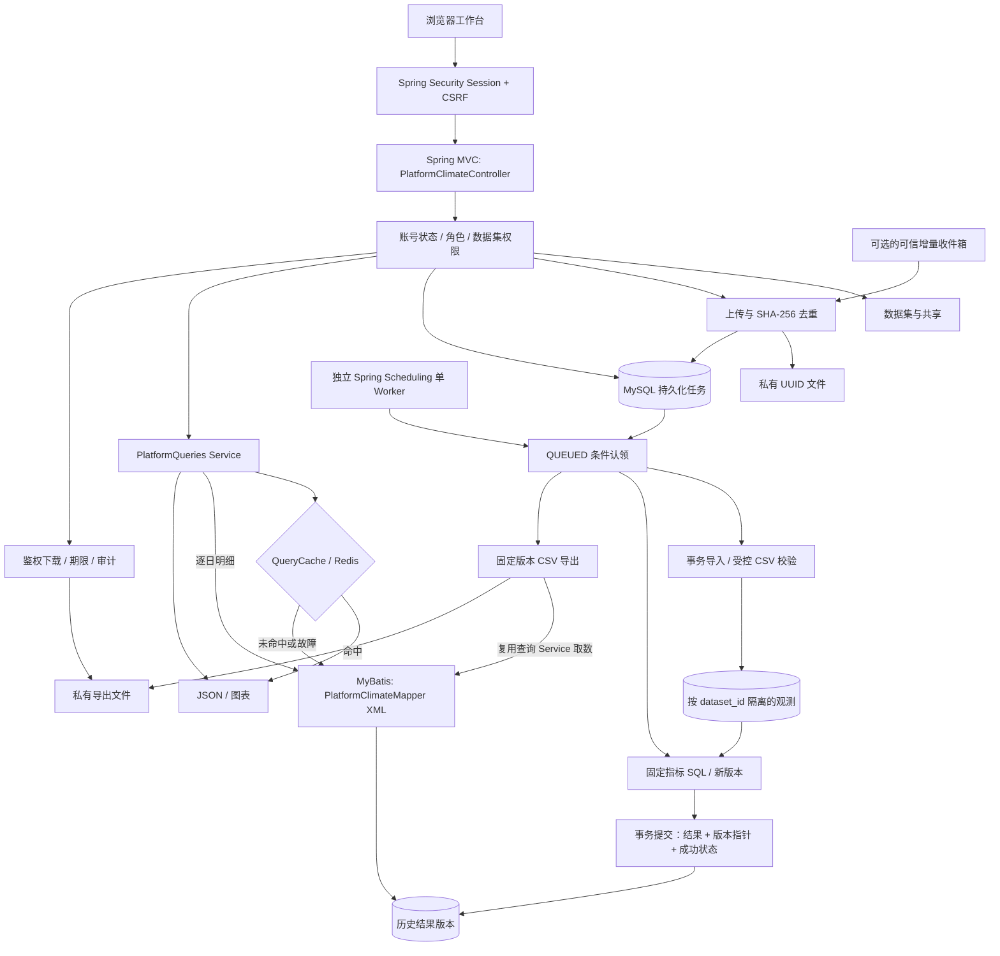

# ClimateLab 业务平台：使用、架构和实现

这是原气象指标查询服务之上的个人业务化扩展，面向一个内部课题组，单实例运行。它不是对 2022–2024 年实习职责的补写，也没有声称存在真实线上用户或生产流量。

## 一、启动与账号

```bash
cd /Users/zuoxu/Desktop/recruitment/ucas-climate-service
python3 scripts/local_auth.py
docker compose --env-file .runtime/auth.env up -d --build
python3 scripts/platform.py credentials
```

浏览器访问 `http://127.0.0.1:8087/`。账号为 `admin`，密码来自私有 `.runtime/auth.env`。命令 `credentials` 会明确打印此密码供你自己复制，不要把终端输出放进截图、Git 或分享链接。

`local_auth.py` 会保留已有两枚 API Key，另加一份随机平台管理员初始化密码。首次启动时将密码以 BCrypt（cost 12）保存到数据库；之后不自动重置账号。文件权限为 0600，并被 Git、Docker 构建忽略。

本机调试仍可使用 `bash scripts/native-dev.sh run`，脚本已经加载平台初始化密码。Docker 与原生开发的数据目录各自独立，请勿同时占用 8087/13306/16379，也不要让两份平台连接同一数据库。

### 身份与权限

| 角色 | 能力 |
| --- | --- |
| ADMIN | 创建、启用/停用账号；访问与管理普通数据集；不能写入只读示例 |
| RESEARCHER | 创建自己的数据集；按授权读取或编辑共享数据集 |
| VIEWER | 查询获授权数据，提交只读结果导出；不能创建、导入、计算 |

数据集所有者和管理员可以按用户名分配 READ、WRITE 或 REMOVE。READ 允许结果、文件记录、任务和导出读取；WRITE 额外允许导入和计算，不允许继续给别人授权。所有查询、缓存读取和下载都先检查数据集权限；无权资源返回 404，不暴露其存在性。

前端使用 Spring Security Form Login 和 HttpOnly Session Cookie，不保存密码或 Token 到 localStorage。登录前获取 CSRF Token，所有状态修改携带请求头；登录后重新获取 Token。连续失败 5 次锁定账号 5 分钟；成功登录清零失败次数。停用账号后，每次业务请求和任务开始时检查数据库状态。没有公众注册、找回密码、短信、OAuth、跨实例会话或单点登录。

Session 默认 30 分钟；重启应用后需要重新登录。数据和任务持久化不等于会话持久化。仅监听本机；若跨机器使用，必须补 HTTPS、Secure Cookie、网络访问控制、备份和运维策略，不要直接裸露本例 HTTP。

## 二、完整操作流程

### 1. 先用只读样本认识业务

登录后选择“真实气象样本 · 只读示例”。它是旧查询服务的一次性快照，包含 26,004 条观测、三个站点和 4,185 条逐日分析结果（原数据库有额外增量时可能不同）。

这个示例不是全球全量数据，也不保证中间年份连续。管理员和研究人员可点击“复制为我的数据集”；复制后的数据独立存储，可以编辑。示例本身不能上传、重算或修改共享权限。

初始化快照只执行一次，原查询服务之后发生变化不会自动覆盖它。如果旧库为空，先按原 README 导入样本，再重启应用以创建示例。

### 2. 创建自己的数据集

点击“新建数据集”，填写名称和说明。创建者为所有者；其他普通账号默认看不到。单账号最多创建 30 个数据集，工作台最多显示 100 个可访问数据集，这是本地学习版本的界限。

“数据概况”展示观测范围、站点、已发布结果版本和缺少阈值的分析观测。原始数据修订号与结果输入修订号不同时，会提醒需要重新计算。

### 3. 上传标准化 CSV

进入“文件与任务”，下载空白字段模板。只接受 UTF-8、以下大小写及列序：

```csv
STATION,DATE,NAME,TEMP,PRCP,HUMIDITY,MAX,MIN,FRSHTT,country,province,city,district
```

字段口径与原服务一致：站点字符编码保留前导零；温度 °F；降水 in；湿度 0–1；天气标记左补成六位；空值保留缺失。不能上传原始 40 列文件或直接上传 API 导出的指标 CSV。

单文件最多 8 MiB、最多 200,000 条输入记录，至少一条观测。单个数据集最终记录数量可通过多批导入累积，当前没有全量容量承诺。

页面显示“上传成功”仅代表文件已暂存且 IMPORT 任务已创建，不代表入库成功。在任务详情查看行号、阶段和错误原因。任务中心每 3 秒刷新；数据集文件页可点击刷新。

相同数据集内，文件 SHA-256 相同就返回原文件及最近任务，不重复导入；另一个数据集可以合法导入同样内容。文件已经失败时，同样内容重传不会绕过失败记录，请手动重试，或修正内容后重新上传。并发相同内容通过唯一约束保护，竞争请求可能得到 409，刷新即可查看已存在的记录。

同站点同日期使用 upsert；“处理行数”指读取的 CSV 记录数，不冒充新增数据库行数。批量写入每 500 行提交给数据库执行，但**整个导入只有一个事务**：最后一行错误也会回滚之前批次，文件和任务记录仍保留失败原因。

### 4. 计算与版本发布

导入成功后点击“重新计算指标”。生成 ANALYZE 任务，接口立即返回任务 ID；后台固定单 Worker 执行。

计算口径保持原实现：1973–1992 为基准窗口；温度 P10/P90、降水 P95/P99、湿度 P5 使用 nearest-rank；1993 年起生成七幅度和六天气指标。最少基准样本数默认为 30，各变量分别排除 NULL。没有基准阈值的分析观测会计入缺失数量，不被冒充为零结果。

计算写入一个新的结果版本，完成后在同一个事务中保存计算记录、切换 active_result_version、标记任务成功。失败则回滚新结果，仍可查询旧成功版本。

固定公式不提供任意 SQL、公式编辑器或自定义基准窗口。用户的站点、日期和地区是**查询筛选条件**，不是更改计算定义。

### 5. 分析结果

“结果分析”提供五种查询：站点阈值、逐日指标、站点年度频次、地区逐日统计、地区年度统计。选择历史版本可以复查旧结果。

图表仅显示当前页，逐日默认显示 HTD；缺失值和日期空档断线，不补零。年度显示非零观测天数，不是全年发生概率。阈值有不同单位，使用表格分别核对，不混画到一个纵轴。

页面每页 200 条，后端允许最多 500 条。地区日统计只计算七个幅度指标；年度统计包含所有十三类指标。接口可额外按 province/city/district 筛选，第一版 UI 提供层级和国家筛选。

### 6. 导出与下载

使用当前筛选条件点击“导出”，任务固定当时选择的结果版本。在“导出记录”下载 CSV，文件带 datasetId/resultVersion 列，最多 20,000 行、32 MiB。

下载资格默认 7 天；到期返回 410，需要重新导出。每次下载重新校验账号和数据集权限，撤销共享后旧下载地址也不能继续使用。文件保存在私有目录，不通过静态资源路径提供，不返回服务器绝对路径。

文本单元格以 `= + - @` 等公式前缀开头时加引号前缀防止表格软件执行；真正的数值负数仍正常输出。过期文件、旧结果版本和暂存孤儿文件暂不自动删除，需要备份后人工制定保留策略。

## 三、架构



`/`（跳转 `/platform.html`）是唯一主工作台；气象站点、版本列表、五种分析查询和导出取数均经 Spring MVC / Service / MyBatis，未命中缓存才读取结果表。查询 Service 不再持有 JdbcTemplate，也不拼接 SQL。XML 通过 `<choose>` 选择固定查询、通过 `<if>` 处理地区筛选，所有请求值用 `#{...}` 绑定，强制带数据集与结果版本作用域。

登录、共享、持久化任务以及批量导入/计算仍允许用参数化 JdbcTemplate；这不构成另一套气象查询链路，也不声称全平台都由本人在实习中开发。完整调用链和职责边界见 [统一架构](unified-architecture.md)。旧 `/api/**`、原表与旧增量目录仅保留兼容和公式核对，不接管当前平台查询；前端不需要 API Key，平台也不经 HTTP 转调旧 Controller。

新增 Flyway V3 仅创建 `platform_*` 对象，没有改变旧表主键、旧视图、旧公式资源或 V1/V2 校验和。平台观测以 `(dataset_id,station_code,date)` 唯一；结果还增加 result_version；文件指纹以 `(dataset_id,sha256)` 唯一。

## 四、代码模块与实现顺序

Java 根目录 `src/main/java/cn/zuoxu/climate/platform/`：

| 模块 | 职责 |
| --- | --- |
| PlatformSecurity / PlatformUsers | 登录、CSRF、密码编码、账号管理、即时禁用检查 |
| PlatformAccess | 集中执行数据集读取、写入和管理权限检查 |
| PlatformDatasets | 创建、示例复制、共享、上传暂存、文件去重 |
| PlatformTasks | 接收配额、任务创建、查询、重试、阶段更新 |
| PlatformWorker | 独立单线程调度、CAS 认领、失败/重启恢复 |
| PlatformProcessor | 导入事务、计算事务、固定版本导出 |
| PlatformClimateController | 本人重点复盘的 Spring MVC 站点/分析/导出接口；认证由配套模块提供 |
| PlatformQueries | 查询 Service：权限先于缓存、参数规范化、固定版本、调用 Mapper |
| data/PlatformQuery、data/PlatformClimateMapper、mapper/PlatformClimateMapper.xml | 类型化作用域、动态过滤、分页/计数及导出共用 SQL |
| service/QueryCache | 统一 Redis cache-aside、版本/数据集隔离、BigDecimal、故障回源 |
| PlatformInbox | 可选自动目录投递，复用上传与任务路径 |
| PlatformBootstrap | 仅首次创建管理员和只读原数据快照 |
| PlatformController / PlatformPage | 配套管理 REST API、私有文件下载、页面入口 |

从零复现的顺序：先定义数据集和权限 → 建平台表和迁移 → 复用 Observation 校验并实现事务导入 → 把原公式改为 dataset/version 作用域 SQL → 做结果指针发布 → 持久化任务和单 Worker → 查询缓存和私有导出 → 登录与前端联调 → 故障/隔离验证。不是对当年实习开发顺序的虚构。

## 五、并发、事务和恢复边界

这是**单实例、单数据写 Worker**模型。平台的观测和结果只由 Worker 修改；创建数据集和复制只读样本不修改其他数据集。不要直接向平台观测表写 SQL，或同时部署多份应用。

任务通过 `UPDATE ... WHERE status='QUEUED'` 认领，更新一行才执行。所有任务积压上限为 100。接收事务使用 READ_COMMITTED，并锁定一行 queue_guard 串行化配额检查；不锁执行中任务行，不长时间持有数据集父行锁，以免外键检查使新上传等待整场计算。

后台处理通过独立 Spring Bean 的 `@Transactional(rollbackFor=Exception.class,timeout=120)` 执行，不靠同类自调用触发事务。阶段计数用独立短事务更新；失败计数可能显示已经解析/尝试处理的行数，不表示这些行已成功提交。

进程使用数据目录文件锁阻止同目录双 Worker。它不是跨机器租约，也不能防止不同目录的两份应用错误连接同一数据库。

重启时：QUEUED 保留继续执行；RUNNING 标记 INTERRUPTED，人工重试生成新 ID，保留旧记录。没有“运行中任务绝不重复”“所有故障绝不丢失”的承诺。数据库不可用时状态保存可能失败，恢复后需检查与重启。

文件系统和数据库不是一个事务：文件已写入但数据库提交失败时，可能留下不可下载的孤儿文件；导出元数据已提交但卷丢失时，下载返回 410。MySQL 卷与 platform-data 卷需要一起备份，不能只备份数据库。

新结果指针只代表派生结果版本。原始观测采用 upsert，没有历史快照；无法仅凭版本号重建过去的全部原始输入。公式版本、输入修订、输出版本及导出文件可追踪，不冒称完整数据血缘平台。

## 六、自动增量收件箱

默认关闭。需要时在环境中设置 `CLIMATE_PLATFORM_INBOX_ENABLED=true` 后重建 app；与旧 `CLIMATE_INCREMENTAL_ENABLED` 是不同入口。

目录：`<CLIMATE_PLATFORM_DIRECTORY>/inbox/<数据集ID>/`。创建普通数据集时自动创建对应子目录。仅可信服务器操作人员可以写入这个目录，自动任务以数据集所有者身份提交，并额外记录 `AUTO_IMPORT_AS_OWNER`，不冒充用户在浏览器主动提交。

发布方式：先写 `batch.part`，关闭后在同目录原子改名 `batch.csv`，默认稳定 30 秒才处理。只检查直接子目录中的普通 .csv 文件，不跟随符号链接、不递归读磁盘、不扫描 45 GB 数据。先生成有界稳定快照，再复用与网页完全相同的 SHA-256 去重和 IMPORT 任务入口。

每个数据集收件箱最多 500 个 .csv 文件，超过时明确记录警告并暂停该目录，需人工归档已处理输入。每轮轮转检查最多 20 个数据集、100 个文件，新增最多 5 个导入任务；定时轮询间隔 10 秒。原文件保留，重复内容不会重复导入。坏文件不会反复自动重试，需修正内容或在任务中心手动重试。

**自动导入不会自动发布新指标**。页面会显示数据修订已更新，研究人员确认后提交计算。这是当前受控的两步流程，不是任意文件一落地就自动发布科研结果。

Docker 路径为 `/app/.runtime/platform/inbox/<id>/`，位于持久化命名卷。不要把 45 GB 原文件放进来。

## 七、验证、日志与运行维护

```bash
# 原有 + 新增测试，全部使用 _test 库
CLIMATE_IT=true mvn -B -ntp test

# 实际运行的完整平台业务，不使用模拟计算
python3 scripts/platform.py verify

# 原气象结果的独立 Decimal 核对
python3 scripts/verify_live.py --report .runtime/platform-legacy-oracle.json

# 查看后台任务日志
docker compose --env-file .runtime/auth.env logs -f app
```

端到端验证会新建明确命名的验证账号与两个数据集，读取现有 `data/sample.csv`，不删除既有数据；重复运行会留下新的验证记录。报告保存在 `.runtime/platform-verification.json`，不含密码。

修改源码后：Docker 用 `up -d --build app`；本机运行先停 JVM，再打包、重启，不覆盖正在使用的 JAR。正常停止使用 `docker compose ... down`，不要加 `-v`，否则会删除 MySQL 与私有文件卷。

代码升级前的源文件备份在 `.runtime/backups/before-platform-20261019.tar.gz`；它不是数据库备份。已发布的 V3 迁移不可修改，需要改结构时新增 V4。

## 八、面试应如何表述

> 原实习的主线是按指标说明写 SQL，并参与把查询接成后端。后来我基于保留的数据和查询，个人复建并扩展成一个内部气象分析平台，加入数据集权限、任务执行、结果版本发布和可操作页面。核心难点是把数据集作用域落实到主键、聚合和缓存，把长任务与 HTTP 解耦，以及保证失败计算不会覆盖成功结果。

可以深入讲述：多数据集相同站点日期为什么不冲突、权限撤销后为何缓存不能绕过校验、为什么发布结果用版本指针、导出为何固定版本、长事务为什么不锁任务接收所需的父行、文件系统与数据库的失败窗口。

没有实现微服务、消息队列、多租户商业 SaaS、任意公式编辑、大规模分布式计算或全量 45 GB 性能验证。前端按 Sites 技能的本地流程组织和验证，实际仍是 Spring Boot 同源静态页面，没有创建或发布外部 Sites。
