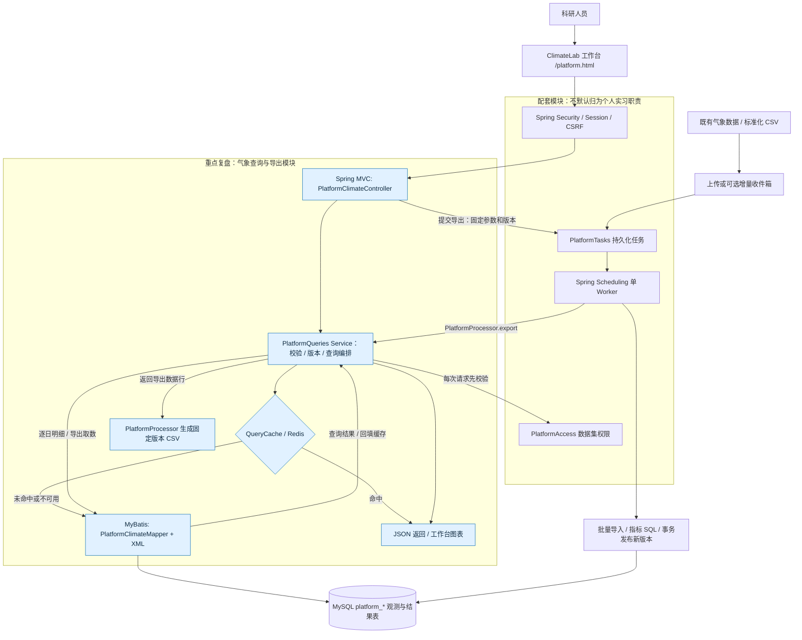

# ClimateLab：统一平台查询架构与个人职责

本次调整的目标是：继续使用完整的 ClimateLab 工作台，但将气象检索、聚合结果读取和导出取数真正接到 Spring MVC + Service + MyBatis，不再让平台绕过 MyBatis 直查数据库。账号和任务模块是配套能力，不应将“整个平台能运行”描述为“当年实习全部由我负责”。

## 1. 现在只有一条平台气象查询主链路



蓝色节点是本次复建中应重点掌握的查询/导出模块，不是原实习贡献的自动证明。可单独导入 Mermaid 工具的源码见 [architecture.mmd](architecture.mmd)。数据库中的 `platform_*` 前缀不是绕过 MyBatis 的标志；使用哪个框架取决于实际 Java 调用和 XML 映射。

## 2. 一次网页查询究竟经过哪里

例如在工作台选择数据集 2、逐日指标、站点和时间范围后，请求为：

```http
GET /platform/api/datasets/2/analysis?kind=DAILY&station=57328099999&from=1993-07-01&to=1993-07-08&limit=100&offset=0
Cookie: JSESSIONID=浏览器自己的会话
```

数据集 ID/站点仅为示例，应从页面当前数据集及站点列表选择，不保证本机恰有此 ID。日期为左闭右开，以上最多包含七天。

1. Spring Security 验证登录会话；Spring MVC 的 DispatcherServlet 将请求交给 `PlatformClimateController.analysis`，绑定路径与查询参数。Spring MVC 是 Spring Boot Web 中已有的部分，不需要再单独启动一个 MVC 服务。
2. Controller 取得当前用户，调用 `PlatformQueries.query`；Controller 不写 SQL，也不负责指标公式。
3. `prepare` 通过 `PlatformAccess` 检查当前数据集读取权限，再解析指定版本或当前已发布版本。权限检查必须发生在缓存读取前，不能因为别人曾缓存过结果就允许越权。
4. Service 校验站点 11 位、日期范围、枚举、分页，构造 `PlatformQuery(datasetId,resultVersion,kind,filters)`。这个对象没有任意 SQL 或表名字段。
5. 逐日明细直接调用 `mapper.selectPage` 和 `mapper.count`；其余四类查询先调用 `QueryCache.readScoped`。缓存命中返回结果；未命中或 Redis 故障，回到同一个 Mapper 查库。
6. MyBatis 执行 `mapper/PlatformClimateMapper.xml` 的固定语句，用 `#{...}` 绑定值。结果查询必带 `dataset_id` 和 `result_version`；逐日查询另外绑定站点、起止日期、limit、offset。计数复用同一组过滤条件，不带多余排序。
7. Service 返回 `{datasetId,resultVersion,parameters,items,total,limit,offset}`；Spring MVC/Jackson 转成 JSON，页面展示表格和图表。接口同时返回 `X-Cache`。

站点列表走 `PlatformClimateMapper.stations`，按数据集过滤当前原始观测；结果版本列表走 `versions`，按数据集过滤计算记录。这两个列表不是历史原始数据快照。

## 3. XML 动态 SQL 如何落地

实际文件为 `src/main/resources/mapper/PlatformClimateMapper.xml`：

```xml
WHERE dataset_id=#{q.datasetId} AND result_version=#{q.resultVersion}
<!-- DAILY 的固定条件 -->
AND station_code=#{q.filters.station}
AND observation_date &gt;= #{q.filters.from}
AND observation_date &lt; #{q.filters.to}
<!-- 地区查询中按需出现的固定列 -->
<if test="q.filters.country != null">AND country=#{q.filters.country}</if>
```

`<choose>` 在五类固定 SELECT/表/排序之间选择，`<if>` 只控制预先写好的地区条件是否出现，`<include>` 让分页和 count 共用条件。没有 `${}`，也不接受前端传 table/orderBy/任意指标列名。这保留手写 SQL 的可控性，又把 SQL 从 Java Service 中移走，便于讲清楚 MyBatis 的作用。

地区均值、极值、中位数和年度天数在计算任务中提前写入结果表；HTTP 聚合查询读取这些结果。计算仍执行固定的 `sql/platform-rebuild.sql`，没有为了声称“所有地方都用 MyBatis”而改动已经核验的批量计算公式。

## 4. 缓存和导出不是另一套查询实现

统一缓存由 `service/QueryCache` 提供，平台 Key 为：

```text
{app.cache-namespace}:platform:{datasetId}:{resultVersion}:{kind}:{SHA256(规范化筛选参数+limit+offset)}
```

默认 namespace 为 `climate-rebuild`，测试为 `climate-rebuild-test`；TTL 默认 1,800 秒。旧平台 `climate-platform:*` Key 不再读取，会自然过期，无需清空 Redis。新版本使用新 Key，不会读到旧版本结果；同数据集共享者可以复用结果，但每个请求仍重新检查权限。小数缓存读取保持 BigDecimal，Redis 异常时查 MySQL。缓存命中只省略结果表 SELECT/count，权限和版本存在检查仍会查数据库，不声称 HIT 是零 SQL。

异步导出流程为：

```text
PlatformClimateController.export
  → PlatformQueries.prepare：授权、筛选参数与版本固定
  → PlatformTasks.enqueue：持久化 EXPORT 任务，返回 202
  → PlatformWorker → PlatformProcessor.export
  → PlatformQueries.exportRows：执行时再次检查授权
  → 同一个 PlatformClimateMapper.selectPage / XML
  → 私有 CSV → 下载时再次鉴权
```

导出不读缓存；固定当时选择的版本，不能执行到一半改用新的 active version。当前导出上限 20,000 行，取 20,001 行作为超限探测，文件上限 32 MiB；不是无限制大数据流式下载。字段顺序由 XML SELECT 和 LinkedHashMap 保持。

## 5. 哪些能力属于你的重点，哪些是配套

| 范围 | 当前实现 | 面试时如何划界 |
| --- | --- | --- |
| 指标口径与 SQL | 既有说明、SQL 草稿、四阶段计算、结果核对 | 第一次实习以从数据库取数、指标查询/计算为主，只讲实际参与部分 |
| 检索、聚合、导出接口 | Spring MVC + Service + MyBatis XML，筛选分页与统一取数 | 第二次把已有 SQL 接到后台，应重点掌握这个调用链；历史细节不确定时说明复盘重建 |
| MySQL/Redis/增量 | 数据集/版本索引、cache-aside、Spring Scheduling 收件箱与 Worker | 当前实现可实际演示；容量、TTL、任务状态机等是本次复建选择，不伪称当年原样实现 |
| 登录、用户角色、共享、任务中心、页面 | 安全和业务配套模块；部分管理/写入仍用参数化 JdbcTemplate | 可以说明接口接入已有登录态/权限校验，不把完整认证或整个平台设计都归为自己的实习贡献 |

一种与目前已知经历相符的表达：

> 我参与的是气象数据查询分析模块。第一阶段主要根据指标说明整理 SQL、从数据库查询并核对结果；第二阶段把已有查询接到后台，重点是检索、聚合和导出接口。现在复建版通过 Spring MVC 接收参数，Service 校验并组织查询，MyBatis XML 执行 SQL，重复的小型结果使用 Redis。登录、账号等属于平台配套模块，不是我全部负责的部分。

不要把复建中特定的版本发布、用户管理、单 Worker 机制当成当年系统的历史事实，也不要虚构 QPS、提速比例、线上用户数或独立负责整个系统。这个平台让你有代码可以理解、复现和验证，不替代真实经历证据。

## 6. 原 `/api` 为什么还在

旧 API Key 查询服务保留为兼容/公式验证入口，操作旧业务表；当前平台不调用它、不把平台查询转发给它、也不自动从旧库读结果。旧库只在首次初始化时给平台提供只读示例快照，后续平台自己的查询、计算和导出全用 `platform_*` 数据。保留旧表避免无关数据迁移与破坏原验证，不代表工作台存在第二条绕过 MyBatis 的查询路径。

改造没有修改 V1/V2/V3 迁移或清空已有数据；现有数据集/结果/文件继续可用。页面路径与请求契约不变，启动重建后的 app 后重新登录即可。

## 7. 如何验证不是只改了图

`PlatformIntegrationTest` 使用真实 MySQL、Redis、随机端口 HTTP，并安装测试专用 MyBatis Executor 插件记录真正执行的 MappedStatement：

- 站点与版本列表执行对应 Mapper；五类分析请求执行 `selectPage`/`count`，校验数据集、版本、参数化 SQL 和部分已知数值。
- 同一请求第二次 Redis HIT 不再执行结果 Mapper，但撤销共享后即使有热缓存也返回 404。
- 五类异步 CSV 导出均执行同一个 `selectPage`，而非另一套 JDBC 查询。
- 原有跨数据集隔离、公式、导入回滚、版本固定和下载权限测试继续运行。

完整执行方式和实际结果见 [platform-verification.md](platform-verification.md)。运行普通 `mvn test` 而没有 `CLIMATE_IT=true` 会跳过真实数据库集成测试，不能据此声称整条链路已验证。
